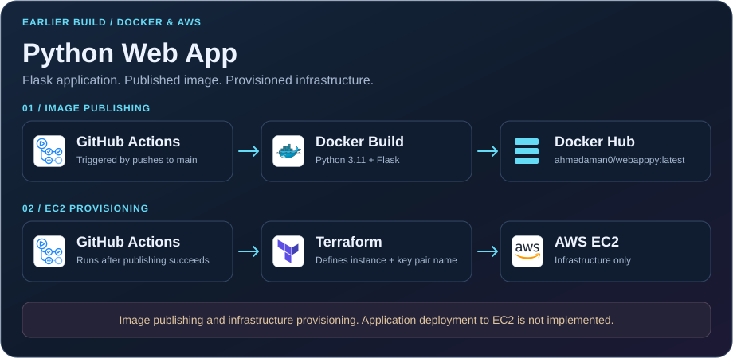

# Python Web App | Docker & AWS Provisioning


An earlier DevOps learning project combining a Flask application, Docker image publishing with GitHub Actions, and AWS EC2 provisioning with Terraform.

**Scope:** the workflow builds and publishes the application image and provisions an EC2 instance. It does not install Docker on EC2, deploy the application to the instance, or run automated tests.

## What It Demonstrates

- **Python application:** a Flask endpoint returning `Hello, DevOps World!`.
- **Containerization:** a Docker image using Python 3.11.
- **Image publishing:** GitHub Actions builds the image and pushes it to Docker Hub.
- **Infrastructure as code:** Terraform defines an AWS EC2 instance and outputs its public IP.

## Project Structure

```text
.github/
  workflows/
    deploy.yml       # Image publishing and Terraform provisioning
app.py               # Flask application
requirements.txt     # Flask dependency
Dockerfile           # Application container
main.tf              # AWS provider and EC2 resource
variables.tf         # Infrastructure configuration
README.md
```

## Run Locally

Requires Git and Docker.

```sh
git clone https://github.com/aman-ahmed0/webAppPy.git
cd webAppPy

docker build -t webapppy:local .
docker run --rm -p 127.0.0.1:5000:5000 webapppy:local
```

Open **http://localhost:5000**.

Expected response:

```text
Hello, DevOps World!
```

Stop the container with **Ctrl+C**.

The application uses Flask's development server. This is a learning setup, not a production application server.

## GitHub Actions Workflow

The workflow runs on pushes to `main`.

### Image Build and Publishing

1. Checks out the repository.
2. Sets up Python 3.11 and installs dependencies.
3. Builds the Docker image.
4. Signs in to Docker Hub and pushes:

```text
ahmedaman0/webapppy:latest
```

The Docker Hub image destination is hard-coded in the workflow. Anyone adapting this project must replace it with a repository they can publish to.

### AWS Infrastructure Provisioning

After the image publishing job succeeds, the provisioning job:

1. Checks out the repository.
2. Sets up Terraform 1.6.0.
3. Loads AWS credentials from GitHub secrets.
4. Writes an SSH private key to a runner-local file.
5. Runs Terraform initialization and applies the EC2 configuration.

Despite the job being named `deploy`, it provisions infrastructure only. There is no step that connects to EC2 or starts the application container there.

## Workflow Secrets

| Secret | Current use |
|---|---|
| `DOCKER_HUB_USERNAME` | Docker Hub sign-in |
| `DOCKER_HUB_PASSWORD` | Docker Hub sign-in |
| `AWS_ACCESS_KEY_ID` | AWS authentication for Terraform |
| `AWS_SECRET_ACCESS_KEY` | AWS authentication for Terraform |
| `AWS_SSH_PRIVATE_KEY` | Written to `my-aws-key.pem` on the runner |

The private key file is not used by a subsequent SSH or deployment step. It does not create the EC2 key pair.

Do not commit credentials, private keys, Terraform state or credential-bearing variable files.

## Terraform Configuration

Terraform files are at the repository root.

| Variable | Repository default |
|---|---|
| `aws_region` | `us-east-1` |
| `instance_type` | `t2.micro` |
| `ami_id` | `ami-08b5b3a93ed654d19` |
| `ssh_key_name` | `my-aws-key` |

Before provisioning, confirm that the selected AMI is available and suitable in the chosen region, and that the EC2 key pair already exists there.

The workflow explicitly passes `ssh_key_name=my-aws-key`.

The configuration does not define application installation, instance bootstrap commands, or application-specific security group rules.

## Important Limitations

- No automated tests, container smoke tests or vulnerability scans.
- No application deployment to EC2.
- Docker images use the mutable `latest` tag.
- AWS authentication uses stored credentials rather than OIDC.
- Terraform has no remote backend configured.
- The workflow does not persist Terraform state between runs.
- Terraform applies changes automatically on pushes to `main`, without a plan-review step.
- The SSH private key is written to the runner but is not used.
- The application uses Flask's development server.

**Do not treat the current provisioning workflow as a reusable production deployment pipeline.** Repeated runs without retained Terraform state cannot reliably manage previously created infrastructure.

## Infrastructure Cleanup

Retain the Terraform state for any resources you create and use that state when reviewing their removal.

The current GitHub Actions workflow does not preserve state or provide a cleanup job. Do not assume a fresh local checkout can discover or remove instances created by earlier workflow runs.

The `FreeTierEC2` resource tag is a name, not a guarantee that provisioning is free.

## Next Improvements

- Add application tests and container smoke checks.
- Scan images before publishing.
- Use commit-based image tags.
- Replace stored AWS credentials with OIDC authentication.
- Configure remote Terraform state.
- Separate plan review from infrastructure application.
- Add an explicit, documented application deployment step.
- Remove the unused private-key handling unless deployment requires it.

## Implementation References

- [Flask application](app.py)
- [Dockerfile](Dockerfile)
- [GitHub Actions workflow](.github/workflows/deploy.yml)
- [Terraform infrastructure](main.tf)
- [Terraform variables](variables.tf)
